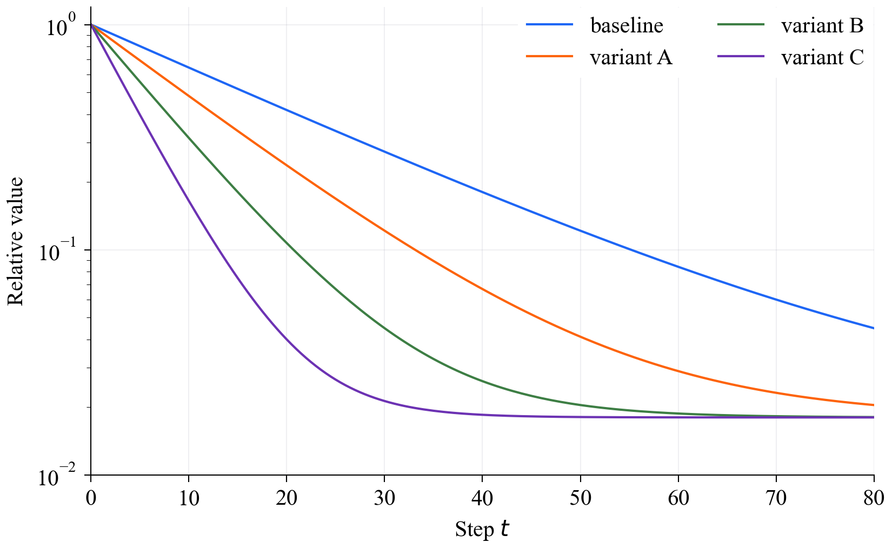
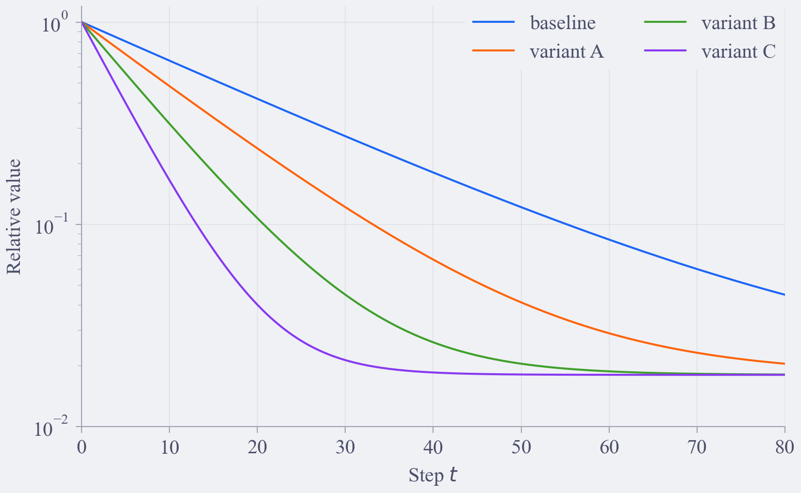
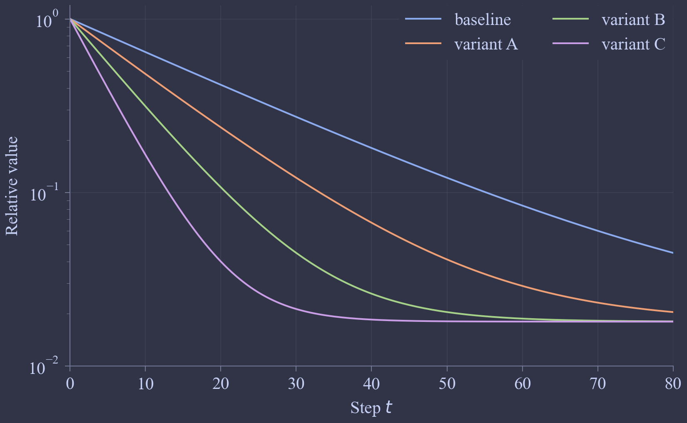
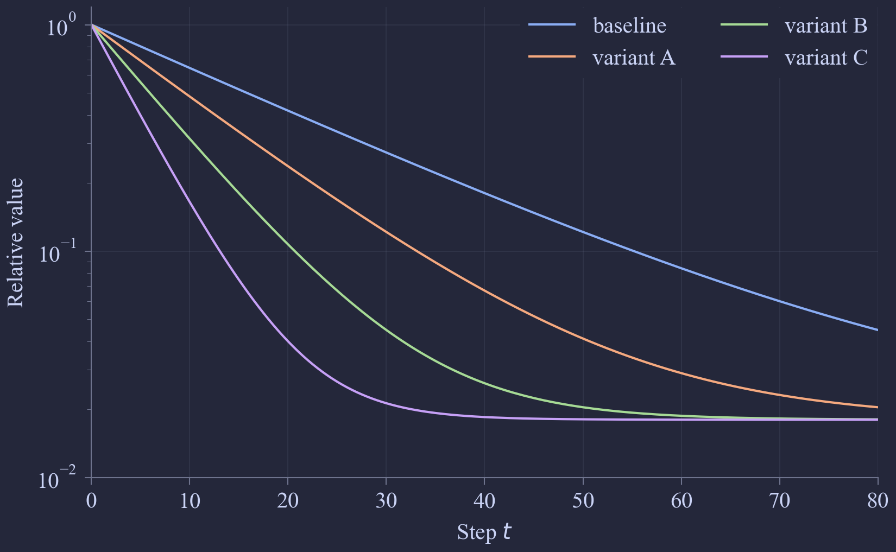
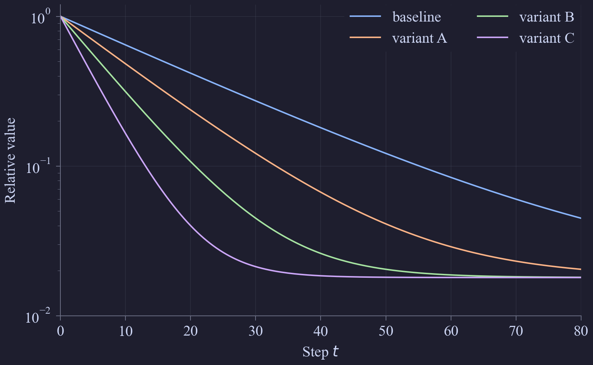
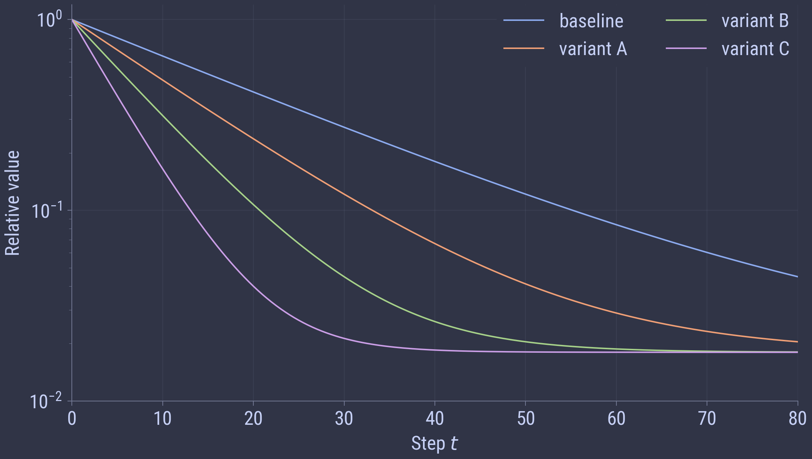

# figmint

`figmint` is the figure package in the mint stack. It produces academic figures from Python (matplotlib) and from inside a LaTeX document (pgfplots). Both backends share the same themes, color palette, legend optimizer, and venue-aware sizing. The matplotlib backend uses `style(...)` before the plot and `legend(axis, ...)` in place of `axis.legend(...)`; the pgfplots backend needs only `\usepackage{figmint}` and the `figmint` style on the axis.

The default `normal` theme uses a categorical color cycle repaired for WCAG non-text contrast on white backgrounds and CIEDE2000 separation across normal and simulated color-vision modes. Four official [Catppuccin](https://catppuccin.com/) palettes round out the themes: one light (`latte`) and three dark (`frappe`, `macchiato`, `mocha`). Venue presets for ICML, ICLR, and NeurIPS derive font and figure dimensions from the caption setup. Both backends place legends by the same rule: the legend sits flush at one of nine anchors of the axes, with the column count that covers the least plotted ink.

Figures from `figmint` end up in papers (compiled with `papermint` and `macromint`), beamer slide decks (compiled with `slidemint`), Keynote and Google Slides decks, blog posts, and READMEs. The choice between the two backends tracks where the figure is composed, not where it ends up.

## Gallery

`normal`



`latte`



`frappe`



`macchiato`



`mocha`



`frappe` with overrides



## Installation

The Python package and the TeX package install independently.

### Python

`figmint` is not yet on PyPI. Install from a local clone:

```sh
pip install .
```

When published, the package will be installable directly using

```sh
pip install figmint
```

### TeX

Install `figmint.sty` into your user TeX tree from the repository root:

```sh
l3build install
```

Confirm TeX can find it:

```sh
kpsewhich figmint.sty
```

## Two backends

The matplotlib backend draws figures from Python. The pgfplots backend draws figures inside a LaTeX compile.

The pgfplots backend is what you reach for when the figure lives inside a LaTeX document, such as a paper compiled with `papermint` and `macromint`, or a beamer slide deck compiled with `slidemint`. The document hands the figure its font, font size, column width, and theme. Per-figure styling code is zero.

The matplotlib backend is what you reach for when no LaTeX compile is around the figure: Jupyter sessions, Keynote and Google Slides decks, automated reports, blog posts, README images. The matplotlib backend covers three levels of control, from a single venue preset to LaTeX-typeset text inside a Python-drawn figure.

`export_table` and `export_heatmap` bridge the two backends. When an experiment runs in Python but the figure belongs in TeX, dump the numbers to a `.tsv`, or a dense scalar field to a `.png`, and let pgfplots draw them.

## PGFPlots backend

Load the package and use the `figmint` style on a pgfplots axis:

```tex
\usepackage{figmint}

\begin{tikzpicture}
  \begin{axis}[
    figmint,
    xmin=0, xmax=80,
    ymin=0, ymax=1,
    xlabel={Step $t$},
    ylabel={Relative error},
  ]
    \addplot+[figmint line, domain=0:80, samples=81]
      {0.08 + 0.90 * exp(-0.045 * x)};
    \addlegendentry{baseline}
    \addplot+[figmint line marks, domain=0:80, samples=9]
      {0.06 + 0.92 * exp(-0.07 * x)};
    \addlegendentry{method}
  \end{axis}
\end{tikzpicture}
```

The `figmint` axis style inherits font and font size from the document's caption setup, the figure width from `\linewidth`, `\columnwidth`, or `\textwidth` depending on `column`, and the theme from `\figminttheme`. Plot styles like `figmint line`, `figmint line marks`, `figmint scatter`, `figmint filled scatter`, `figmint bar`, `figmint horizontal bar`, `figmint area`, `figmint interval`, `figmint heatmap`, `figmint colorbar`, and `figmint boxplot` select per-plot defaults: which grid axis to show, the fill, the marker, the error-bar style. At `\end{axis}`, the legend is placed by the rule in [`docs/legend.md`](docs/legend.md).

### Legend placement

By default, a legend goes to the anchor and column count that cover the least plotted ink, as specified in [`docs/legend.md`](docs/legend.md). figmint typesets the real legend at every column count to measure it. `legend pos=north east` (and the other inner corners) keeps that corner and still chooses the column count. `figmint legend manual` leaves the legend to PGFPlots, for a legend outside the axes or at `legend style={at=...}`; `legend pos=outer north east` implies it. Axes without legend entries are not inspected, so they keep the Lua backend of PGFPlots.

### Themes

The default theme is `normal`. Switch globally with `\figmintsettheme`:

```tex
\figmintsettheme{frappe}
```

Supported themes: `normal` (figmint's white-background palette) and the four official Catppuccin palettes (`latte`, `frappe`, `macchiato`, `mocha`). The TeX package exposes every theme color as a named LaTeX color (`FigmintWhite`, `FigmintBlack`, `FigmintLatteBlue`, `FigmintFrappeBlue`, and so on) for use in document text or custom plot styling.

### Knobs

`\figmintset{...}` accepts:

- `theme`
- `column`: `auto`, `half`, or `full`
- `width fraction`
- `rows`, `cols`
- `height to width ratio`
- `figure width`, `figure height`, `figure size`
- `primary font`, `secondary font`
- `line width`
- `grid alpha`
- `group horizontal sep`, `group vertical sep`
- `colorbar width`, `colorbar sep`, `colorbar tick label width`
- `tick label shift`
- `grouped bar width`, `bar group width`

`column=auto` resolves to `\linewidth`; `column=half` to `\columnwidth`; `column=full` to `\textwidth`. `\figmintset` checks the theme, column, width fraction, rows, cols, height to width ratio, line width, grid alpha, and figure size where they are set, and raises a TeX error for an unknown name, a size or count that is not positive, a count that is not an integer, or a grid alpha outside $[0, 1]$.

## Matplotlib backend

The Python API exposes five names:

```python
from figmint import style, legend, register_fonts, export_table, export_heatmap
```

`style(...)` returns matplotlib rcParams. `legend(axis, ...)` creates the legend of an axes and places it. `register_fonts(...)` makes matplotlib aware of font files on disk when its cache fails to find them. `export_table(...)` and `export_heatmap(...)` are the bridge to the pgfplots backend.

Saved figures use 600 dpi for everything matplotlib rasterizes: images such as those from `imshow`, artists drawn with `rasterized=True`, and PNG output. At matplotlib's default of 100 dpi, an `imshow` heatmap in a PDF is a coarse bitmap.

The backend exposes three levels of control. Each level declares what the surrounding document would have declared on the pgfplots side.

### Level 1: Venue preset

Pick a theme and a venue. The venue stands in for the parts of paper layout the figure cannot see for itself.

```python
import matplotlib.pyplot as plt
from figmint import legend, style

with plt.rc_context(style("normal", venue="icml", column="half")):
    figure, axis = plt.subplots()
    axis.plot(xs, ys, label="baseline")
    axis.set_xlabel(r"$x$")
    axis.set_ylabel(r"$f(x)$")
    legend(axis, loc="best")
    figure.savefig("figure.pdf")
    plt.close(figure)
```

The venue controls text font (Times-style), font size (caption-derived: 10 pt for ICLR and NeurIPS, 9 pt for ICML), figure width (5.5" for ICLR and NeurIPS, 3.25" or 6.75" for ICML), and layout. Choose one of `venue="iclr"`, `venue="neurips"`, `venue="icml"`. ICML supports `column="half"` and `column="full"`; ICLR and NeurIPS use `column="full"`.

To apply the style globally:

```python
plt.rcParams.update(style("normal", venue="icml", column="half"))
```

### Level 2: Custom fonts and sizes

When the figure is meant for a deck that does not share the paper's typography, override the venue defaults:

```python
with plt.rc_context(
    style(
        "frappe",
        venue="icml",
        column="half",
        text_font="Roboto Condensed",
        font_weight="light",
        font_size=13.0,
        figure_size=(7.5, 4.25),
    )
):
    figure, axis = plt.subplots()
    ...
```

`text_font` sets the matplotlib text family. `font_weight` propagates to labels and titles. `font_size` overrides the venue's caption-derived size. `figure_size` overrides the venue-and-column width.

Matplotlib's font cache is notoriously stale: a font already installed on the system may not appear in matplotlib's font list, or may surface under an unexpected family name. `register_fonts(...)` bypasses the cache and registers font files directly with matplotlib's font manager. Call it once before rendering:

```python
from pathlib import Path
from figmint import register_fonts

register_fonts(
    Path.home() / "Library/Fonts/RobotoCondensed-VariableFont_wght.ttf",
    Path.home() / "Library/Fonts/RobotoCondensed-Italic-VariableFont_wght.ttf",
)
```

### Level 3: LaTeX typesetting

When text and math should be typeset by LaTeX itself even from a Python-drawn figure, switch the backend:

```python
with plt.rc_context(style("normal", venue="icml", column="half", backend="pgf")):
    figure, axis = plt.subplots()
    ...
```

`backend="pgf"` returns PGF backend rcParams with `tex_compiler="pdflatex"` by default. The package builds the PGF preamble so the venue's text setup matches the paper: `\usepackage{times}` for ICLR and ICML, `\rmdefault=ptm` and `\sfdefault=phv` for NeurIPS. Pass `tex_compiler="xelatex"` or `tex_compiler="lualatex"` to use a custom `text_font`; those engines require `fontspec`, which the package injects automatically with `\setmainfont`. `math_font="stix"` selects STIX Two Math under both the native matplotlib path and PGF; under pdfLaTeX the package injects `\usepackage[notext]{stix2}`, under XeLaTeX and LuaLaTeX it injects `unicode-math` with `STIX Two Math`. To take over the preamble entirely, pass a full `pgf_preamble` string; in that case `figmint` stops injecting text and math setup.

`style(...)` is a pure rcParams builder. It does not call `matplotlib.use(...)`, `plt.switch_backend(...)`, or `savefig(...)`. In a script with one output backend, import `matplotlib.pyplot` at the top, enter `plt.rc_context(style(..., backend="pgf"))`, create the figure inside that block, and call `savefig(...)` without a backend argument. Scripts that intentionally mix PGF and native matplotlib output in one process should use matplotlib's own backend API at the switch point.

### `legend`

`legend(axis, **options)` replaces `axis.legend(**options)` once the plot is drawn, before `savefig(...)`. Every candidate legend is created with `options`, so font size, title, spacing, colors, and handles carry over. For `loc="best"`, it places the legend by the rule in [`docs/legend.md`](docs/legend.md), which the pgfplots backend shares: the legend sits flush at one of nine anchors, with the column count that covers the least plotted ink. For a fixed location such as `loc="upper right"`, it keeps that anchor and chooses the column count by the same rule. For explicit axes coordinates such as `loc=(0.3, 0.4)`, it moves the lower left corner of the legend to the nearest major grid intersection that keeps the legend inside the axes. The rule chooses the column count and position, so `legend` raises an error for options that set them, such as `ncols`, `bbox_to_anchor`, `borderaxespad`, and `mode`. `axis.legend` remains the way to a manual layout. `legend` draws the figure once, whatever the number of legend entries.

### Parameters

`style(...)` accepts:

- `theme`
- `venue`
- `column`
- `width_fraction`
- `rows`, `cols`
- `backend`
- `tex_compiler`
- `pgf_preamble`
- `text_font`
- `math_font`
- `font_weight`
- `font_size`
- `figure_size`
- `line_width`
- `grid_alpha`
- `height_to_width_ratio`

## `export_table`

`export_table` writes Python data to tab-separated tables that pgfplots can read directly. Same-length one-dimensional columns are written column by column:

```python
export_table("paper/data/loss.tsv", x=steps, y=mean, yerr=stderr)
export_table("paper/data/loss_ci.tsv", x=steps, y=mean, ymin=lower, ymax=upper)
```

For a matrix drawn cell by cell with `matrix plot*`, pass one two-dimensional value column plus one-dimensional `x` and `y` coordinates. The value matrix has shape `(len(y), len(x))`:

```python
export_table("paper/data/heatmap.tsv", x=widths, y=depths, z=values)
```

The exporter writes data only. Plot type, axes, legends, colors, and layout stay in LaTeX through pgfplots and `figmint.sty`.

## `export_heatmap`

`export_heatmap` writes a dense scalar field as a PNG for `\addplot graphics`, for continuous fields such as a density, a loss over a parameter grid, or predictive uncertainty over the input space. pgfplots then draws only the axes, the colorbar, and any overlays, so the compile time does not depend on the number of values. A table drawn with `surf` or `matrix plot*` costs TeX time for every value, which limits it to a coarse grid.

Each value becomes one pixel, colored the way pgfplots colors point meta with figmint's colormap, so the image matches a colorbar over the same range. Give that range to both sides: `vmin` and `vmax` in Python, `point meta min` and `point meta max` in TeX. The value matrix has the shape `(len(y), len(x))` of `export_table` grids, with `y` increasing along the rows. Evaluate the field at the centers of a grid of cells over the plotted rectangle, so that the image covers exactly that rectangle:

```python
cells = 1024
centers = -6.0 + 12.0 * (np.arange(cells) + 0.5) / cells
x, y = np.meshgrid(centers, centers)
export_heatmap("paper/data/entropy.png", entropy(x, y), vmin=0.0, vmax=np.log(2.0))
```

```tex
\begin{axis}[
  figmint, figmint heatmap, figmint colorbar,
  xmin=-6, xmax=6, ymin=-6, ymax=6,
  point meta min=0, point meta max=0.693147,
]
  \addplot[forget plot] graphics[xmin=-6, xmax=6, ymin=-6, ymax=6] {entropy.png};
\end{axis}
```

`forget plot` keeps the image out of the legend and the cycle list, which would otherwise give the first legend entry and the first cycle color to the image. `\addplot graphics` finds the file the way `\includegraphics` does, so set `\graphicspath` when the data lives in another directory. Sample at least as finely as the figure is shown: a panel a quarter of a slide wide spans about 900 pixels on a 4K screen, so it needs about 1000 values per side. Keep `export_table` with `matrix plot*` for a matrix whose cells should stay visible, such as a confusion matrix, since each cell is then a vector rectangle.

## Color choices

The `normal` theme uses a white background, black text, black edges, and a constrained repair of the Catppuccin Latte categorical cycle for line and bar colors. The repair targets white-background academic figures under WCAG non-text contrast and CIEDE2000 categorical separation across normal and simulated color-vision modes. The themed styles (`latte`, `frappe`, `macchiato`, `mocha`) use official Catppuccin values directly; the dark themes set the axes, figure, and saved-output background to the theme base color, so exported plots drop into matching slide decks without a white rectangle. All themes use the `plasma` colormap for scalar data.

See [`docs/colors.md`](docs/colors.md) for the constraints, the objective, and the derivation of the `normal` cycle.

## See also

- [`papermint`](https://github.com/bmucsanyi/papermint): paper math-font package. STIX Two Math through `unicode-math` under XeLaTeX and LuaLaTeX, `stix2` with `notext` under pdfLaTeX.
- [`slidemint`](https://github.com/bmucsanyi/slidemint): beamer theme for slide decks. LuaLaTeX-only.
- [`macromint`](https://github.com/bmucsanyi/macromint): shared macros. Alphabets, delimiters, operators, calculus, recurring notation, references, theorem environments.

## Tests

Python:

```sh
make test
```

TeX:

```sh
l3build check
```

## License

Apache 2.0.
