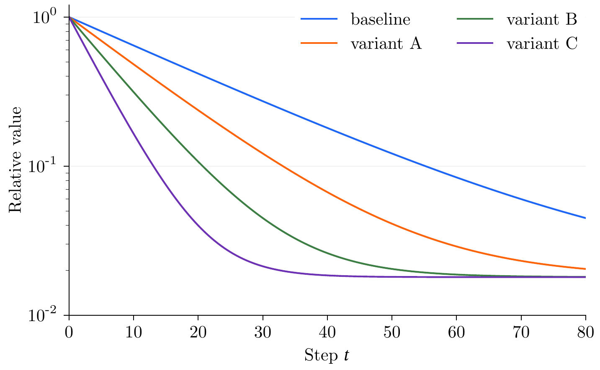
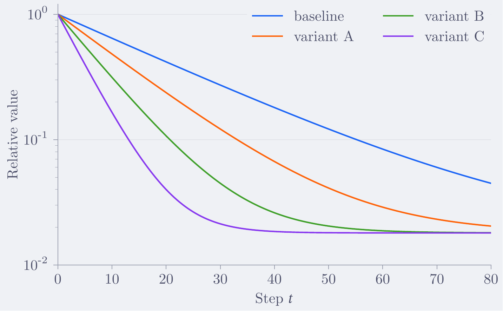
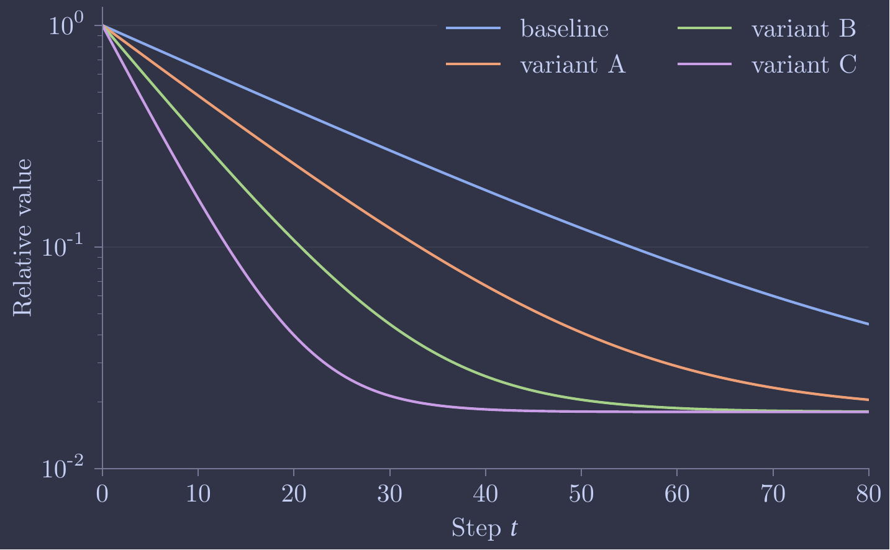
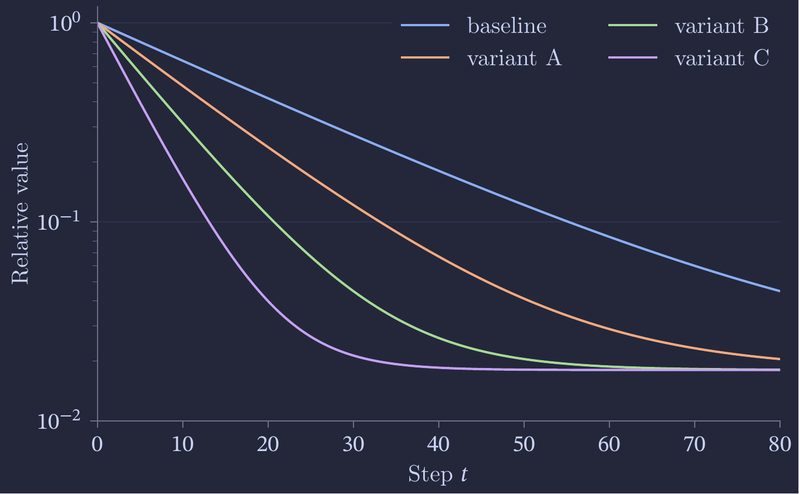
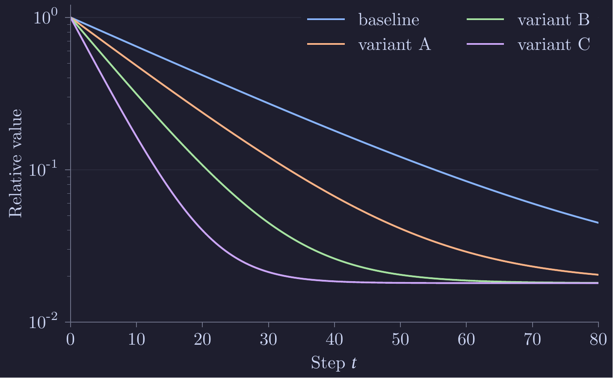

# figmint

`figmint` draws the figures of a LaTeX document with matplotlib, at the size
and in the fonts the document asks for.

## Requirements

Python 3.12 or later with matplotlib, numpy, and pdfminer.six. A TeX Live with
LuaLaTeX, XeLaTeX, or pdfLaTeX. The fonts of a paper come from `papermint`,
those of a deck from `slidemint`.

## Installation

Python, from a clone:

```sh
pip install .
```

TeX, from the repository root:

```sh
l3build install
```

For arXiv, vendor `figmint.sty` into the paper source.

## Usage

Three steps: compile, draw, compile.

The document puts a figure where it belongs:

```tex
\usepackage{figmint}

\begin{figure}
  \centering
  \figmintgraphic{loss}
  \caption{Training loss.}
\end{figure}
```

Every compile writes `main.figmint`: the engine, the directory of the figures,
the preamble lines the figures are drawn with, and for every `\figmintgraphic`
the width and height of the place it stands in, the grid, the theme, and the
caption font there, sampled through the class's own caption command. The width
is `\linewidth` where the command stands, so a column, a `figure*`, a
subfigure, and a Beamer column all measure right. papermint, macromint, and
slidemint declare their preamble lines themselves. A document outside the suite
declares the lines that set its fonts and macros with `\figmintpreamble{...}`
in its preamble; under pdfLaTeX the document's font defaults are written on
their own.

A figure script has one function per figure:

```python
import figmint

document = figmint.Document("main.figmint", results="results/run-3")


@document.figure("loss")
def loss(figure, axes):
    axes.plot(steps, values, label="baseline")
    axes.set_xlabel(r"Step $t$")
    figmint.legend(axes, loc="best")


if __name__ == "__main__":
    document.main()
```

`main` draws every figure whose line changed since it was drawn, the figures
named on the command line, or every figure with `--all`. Before drawing, it
compiles a probe with the engine and the preamble lines and stops when they do
not give the document's fonts and script sizes. A figure is drawn at the size,
the font size, the family, and the theme of its line, through matplotlib's pgf
backend with the document's engine, and saved as `figures/loss.pdf` with its
line in the PDF's `Keywords` and the commit, the script, and the results in its
`Subject`. `axes` comes from `figure.subplots(rows, cols)` with the grid of the
line, as in `\figmintgraphic[rows=2, cols=2]{grid}`. While it draws, the
directory of the file is first on `TEXINPUTS`, where a paper vendors its
packages.

The second compile includes the PDFs at their own size. A PDF whose size differs
from its place by more than 0.01pt gives a warning that prints both sizes, never
an error, so a co-author's compile goes through. A figure not drawn yet leaves
an empty box of its size, so page breaks do not move when it arrives.

`style(theme, figure_size=..., font_size=...)` returns the settings of a figure
that no document includes, with matplotlib setting the text. Save it with
`savefig`, which writes the same provenance.

[`docs/style.md`](docs/style.md) states the look. The plot functions `bar`,
`hbar`, `area`, `interval`, `scatter`, `heatmap`, `colorbar`, and `boxplot`
draw what settings cannot express, `legend` places the legend by
[`docs/legend.md`](docs/legend.md), and every figure saved through figmint
prints its tick numbers without trailing zeros and with a real minus sign.

## Public interface

TeX:

- `\figmintgraphic<overlay>[keys]{name}`.
- `\figmintset{keys}` with `theme`, `width fraction`, `height to width ratio`,
  `rows`, `cols`, `figure width`, `figure height`, and `figure size={w}{h}`;
  `\figmintsettheme{theme}`.
- `\figmintpreamble{lines}` and `\figmintdirectory{path}`, in the preamble.
  The directory defaults to `figures/`.
- The stored values `\figminttheme`, `\figmintwidthfraction`,
  `\figmintheighttowidthratio`, `\figmintrows`, `\figmintcols`,
  `\figmintfigurewidth`, `\figmintfigureheight`, `\figmintplotwidth`, and
  `\figmintplotheight`.
- The colors `FigmintWhite`, `FigmintBlack`, and `Figmint<Theme><Name>` of the
  five themes, such as `FigmintLatteBlue` and `FigmintFrappeBackground`.

Python:

- `Document(path, *, results, repo=None)` with `names`, `figure(name)`, and
  `main(argv=None)`.
- `style(theme, *, figure_size, font_size, line_width=0.5, grid_alpha=0.16)`.
- `legend(axes, **options)`.
- `bar`, `hbar`, `area`, `interval`, `scatter`, `heatmap`, `colorbar`, and
  `boxplot`.
- `savefig(figure, path, *, results=None, repo=None)` and
  `provenance(*, results=None, repo=None)`.
- `export_table(path, **columns)`.

## Gallery

The five themes, drawn through `Document` from a paper with papermint.

`normal`



`latte`



`frappe`



`macchiato`



`mocha`



## Tests

From the repository root:

```sh
make test
l3build check
```

Both need checkouts of `macromint`, `papermint`, and `slidemint` next to this
repository, `pdftoppm`, and `pdfinfo`.

## License

Apache 2.0.
